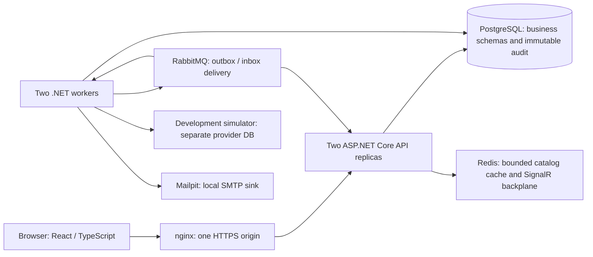

# OrderFlow

A portfolio order-processing application for explaining ASP.NET Core, PostgreSQL concurrency and a React/TypeScript client. It supports catalog/cart → reserved checkout → **simulated** payment → Admin fulfillment, with durable recovery, audit and live notifications. It has no real payment provider, real customers or production-scale claim.

## Architecture and supported flows



A modular monolith with feature folders in one shared Application project/scoped EF Core context; API, Worker and optional simulator are separate processes, not business microservices. PostgreSQL coordinates correctness across replicas. TanStack Query owns server state; Zustand holds bounded cart/UI preferences. Identity HttpOnly cookies and antiforgery protect browser writes; server policies enforce roles/ownership. Hub negotiation uses WebSocket affinity plus Redis fanout under the same origin.

- Customer: registration/login/session restore, keyword/category/sort/paging, exact-cent cart, recoverable checkout/payment requests, own orders/eligible cancellation, notifications and reconnect catch-up.
- Admin: catalog/category archive/restore, audited stock commands, versioned fulfillment, UTC paid-sales/captured/refunded/net reports, low stock and read-only audits; narrowly scoped email failure/retry UI.
- Reliability:15-minute server reservations, atomic stock/order/outbox writes, exact successful checkout replay, signed callbacks, late-capture compensation, bounded retry/lease fencing and inbox deduplication.
- Optional observability: redacted logs, OpenTelemetry traces/metrics and local dashboard. CI and bounded failure/load scripts exist; remote GitHub execution and production operations are separate.

[Checkout/reservation, payment-versus-expiry and outbox/inbox diagrams](docs/flows.md) explain transaction/lock ordering, independent identities, retries and failure recovery. [Acceptance audit](docs/acceptance-audit.md) separates complete behavior from gaps. Standalone stock integration events, enriched order envelopes and general job/outbox/refund operator replay remain incomplete; reporting uses direct PostgreSQL snapshots, not an event projection.

## Quick start: full local demo

Requires Linux/WSL, local Docker Engine/Compose2.24.4+, Python3.12+, OpenSSL and registry access. Docker builds pin Microsoft SDK10.0.404 and Node24.19.0; no host .NET/Node install is required for this manual container demo. Reserve localhost18448/5093/8028 and subnet172.29.246/24. Start from the repository root, using a **new** ignored directory:

```bash
demo_dir="$PWD/.local/portfolio-demo"
python3 infra/demo/demo.py create --directory "$demo_dir"
# Affected snap Docker/AppArmor daemon ONLY: add --snap-compat to create.
python3 infra/demo/demo.py up --directory "$demo_dir"
python3 infra/demo/demo.py check --directory "$demo_dir"
curl --fail --cacert "$demo_dir/tls.crt" https://localhost:18448/api/health/ready
```

Visit **https://localhost:18448**, explicitly trust/except only the generated localhost certificate in your development browser. Open `bootstrap.json` (generated Admin) and `demo.json` (generated Customer) inside that private directory with a private editor. Do not print/commit their passwords. Both use .invalid email; public registration never grants Admin. Fixture **Demo Browse** costs$12.50 with8 units; Replay/Recovery products are reserved for the scripted checks. Customer and Admin should use separate browser profiles.

`up` builds actual frontend/API/worker/simulator images, waits for dependencies, then performs these **explicit one-off steps before serving replicas** (its private phase logs record failures):

```bash
# Expanded operator steps used by up; do not repeat up against a populated DB.
dc=(docker compose -f compose.deploy.yaml -f compose.deploy.demo.yaml --env-file "$demo_dir/deployment.env" --profile deploy --profile demo)
# On the affected snap daemon, insert -f infra/deployment/compose.snap-compat.yaml before --env-file.
"${dc[@]}" run --rm migrate           # Existing EF migrations + runtime-role grants
"${dc[@]}" run --rm bootstrap-admin   # Explicit Development account; no password reset
"${dc[@]}" run --rm initialize-keys   # Protected shared key ring, before cold API readers
"${dc[@]}" run --rm simulator migrate # Separate provider schema
```

The helper additionally seeds one category/three products/opening receipts/one Customer through real cookie+CSRF API calls, after verifying a fresh owned DB. There is no automatic host migration or default password. Latest migration is `20261113082834_AddReportingReadIndexes` (13 total); no new migration for the portfolio audit. Preserve generated secrets with their volumes; changing files does not reinitialize existing DB/broker passwords. For non-demo schema/roles/host development see [persistence](docs/persistence.md), [authentication](docs/authentication.md), [frontend](docs/frontend.md) and [deployment](docs/deployment.md).

Follow the [seven-minute demo](docs/demo.md): browse → checkout → operator simulator payment → Admin Processing/Shipped/Completed → live refresh → duplicate request → broker recovery. No browser URL or countdown proves payment.

```bash
python3 infra/demo/demo.py pay --directory "$demo_dir" --order <UUID-from-Customer-order-URL>
python3 infra/demo/demo.py duplicate --directory "$demo_dir"
python3 infra/demo/demo.py outage --directory "$demo_dir"
python3 infra/demo/demo.py down --directory "$demo_dir"  # Own containers/network only; keep all volumes.
```

Use a real UUID, not the placeholder. Scripts retain original uncertain intention keys/payloads. `up`/seed refuse populated/reused data; choose a new directory for a complete repeat. Never add `down -v` or prune existing volumes. Local certificates/file secrets/single-node dependencies are not production TLS, encrypted secret storage, HA or backup/restore. See [remaining work/v2](docs/remaining-work.md).

## API and checks

[API inventory](docs/project-spec.md#6-rest-endpoint-inventory), [ProblemDetails/money/HTTP contract](docs/http-contract.md), [checkout](docs/checkout.md), [payment/recovery](docs/payment-recovery.md) and [Admin reports](docs/reporting.md) document real contracts. The API process exposes OpenAPI JSON at `/openapi/v1.json` **only in Development**. It is unavailable through the secure Production quick-start proxy (which does not route `/openapi`); use the linked contracts. There is no bundled Swagger UI. [Host development commands](docs/persistence.md) describe configuring the API independently.

Host development/tests use the committed Ubuntu SDK10.0.115, Node24.19.0/npm11.17.0 and lockfiles. CI uses the repository's published container SDK10.0.404 in its disposable checkout, without overwriting the development pin. Install matching Chromium for browser tests; Docker is mandatory for actual PostgreSQL/RabbitMQ/Redis/Mailpit fixtures. No EF InMemory/missing-service success fallback.

```bash
npm ci --prefix client
(cd client && npx --no-install playwright install --with-deps chromium)
bash infra/ci/build-backend.sh
bash infra/ci/test-backend.sh unit
bash infra/ci/test-backend.sh integration
bash infra/ci/test-frontend.sh
bash infra/ci/test-backend.sh browser
# Fresh seeded demo only; consumes its fixtures:
ORDERFLOW_DEMO_DIRECTORY="$demo_dir" node infra/demo/rehearse.mjs
```

See [exact audit checks/results](docs/acceptance-audit.md), [CI](docs/ci.md), [bounded failure/load measurements](docs/load-testing.md), [interview guide](docs/interview-guide.md), [English CV bullets/evidence map](docs/cv.md), [architecture](docs/architecture.md), [ADRs](docs/adr/README.md) and [implementation status](docs/implementation-status.md). Catalog server cache is distributed-only with a30s source deadline at lookup (UI/network can add delay), never checkout truth; local load observations do not establish production capacity or guaranteed speedups.
