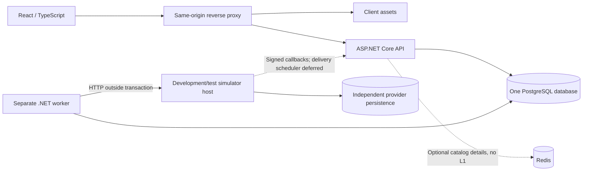

# OrderFlow architecture

Status: accepted design. Milestones 02/02a/03/04/06/07/08 implement host/HTTP/persistence, Identity/resource authorization, Catalog and Inventory balances/stock commands; supplemental 08a strengthens the integration-test harness. Checkout/Active reservations and owner detail reads now ship with milestone 12; release/expiry now ship with 13/14 and signed receipt/consumption/compensation intentions with 17/18; refund recovery now ships with 18 and RabbitMQ outbox publication with the publisher slice of 14; durable order notifications now ship with 23; direct reporting backend now ships under ADR-026; reporting UI remains planned; React session/catalog/cart UI now ships under ADR-027/028. Behavioral contract: [project specification](project-spec.md). Delivery order and evidence: [implementation status](implementation-status.md). Rationale: [ADRs](adr/README.md).

## 1. Deployment and code organization



The simulator is now an optional separately runnable Development/Testing HTTP host (ADR-018 supersedes the earlier worker-adapter-only choice), not a production payment provider. Its state is durable and independently committed, optionally in a separate configured database; it must not participate in the merchant business transaction. API and worker share application logic and schema, but have separate process lifetimes and DI scopes. Stopping the worker must not stop API reads/checkout.

Layout contract (the .NET solution is generated in milestone 02; module implementations, context/migrations, client, and future jobs are added by their own milestones):

```text
src/OrderFlow.Api/                    HTTP composition, controllers, auth, filters
src/OrderFlow.Worker/                 Hosted workers and process composition
src/OrderFlow.Simulator/              Optional restricted Development/Testing provider HTTP host
src/OrderFlow.Application/
  Modules/{Identity,Catalog,Inventory,Ordering,Payments,Notifications,Reporting}/
    <feature>/                       Domain rules, command/query services, DTOs
  Persistence/                       One OrderFlowDbContext, mappings, migrations
  Messaging/                         Outbox/inbox, leases, event contracts
  Common/                            Small actual shared primitives only
client/                              React/TypeScript features and API client
tests/OrderFlow.UnitTests/
tests/OrderFlow.IntegrationTests/     Actual PostgreSQL + HTTP + worker tests
docs/adr/
```

Three production .NET projects are enough. Use feature folders within the application assembly with clearly named services/entities and narrow module interfaces; no separate repository per entity, no generic repository hiding SQL, no event bus or mediator package merely for layering. Domain rules should be small methods/value types where useful; transaction orchestration belongs in application services. Controllers validate HTTP shape, authorize, call one use case, and translate outcomes. API/worker never duplicate core business rules.

The initial solution is `OrderFlow.slnx`. API and Worker each reference Application; UnitTests references Application; IntegrationTests references API/Worker and the optional simulator host. Domain/application/infrastructure are folder boundaries inside Application, as ADR-001 requires. Milestone 02 initially contained boundary documentation and only GET `/api/health/live`; later milestone sections below describe the added features. Worker now registers expiry and opt-in submission/settlement schedulers described below; earlier scaffold milestones had no jobs. See [ADR-007](adr/0007-solution-bootstrap.md) for the scaffold decision and [README](../README.md) for commands.

Milestone 02a adds BCL-only Application/Common primitives for errors/money/time/pagination and API/Http for exception/validation/status mapping, typed JSON conversion, safe structured request logs and Development-only OpenAPI. Both hosts register TimeProvider. No module entity/context/controller CRUD is introduced. The preceding scaffold description records milestone 02; Application now contains these shared primitives. See [HTTP contract](http-contract.md) and [ADR-008](adr/0008-http-application-foundations.md).

Milestone 03 adds the scoped OrderFlowDbContext, explicit Identity storage, IdempotencyRecords/OutboxMessages/ProcessedMessages and initial migration. Connection options are lazy; both hosts can start without connecting and never migrate automatically. An explicit Development-only worker command seeds role definitions; milestone 04 adds a separately enabled account seed command without default credentials or existing-account promotion/reset. [Persistence guide](persistence.md) documents private configuration, separate migration execution, actual PostgreSQL tests, volume lifetime and manual reset. [ADR-009](adr/0009-postgresql-reliability-foundations.md) records the generalized stores and auth/client roadmap adjustment.

Milestone 04 adds API/Auth session orchestration, role policies, secure cookie settings, explicit JSON antiforgery validation and per-process authentication limits. Shared Identity policy/account bootstrap lives in Application/Modules/Identity; [ADR-010](adr/0010-identity-cookie-authentication.md) records the choices. No new schema/package is needed.

Milestone 06 adds ICurrentUser/IOwnedResource contracts in Application/Common/Authorization and ASP.NET Core policies/handlers in API/Auth/Authorization. Scoped ResourceAccess maps explicit permission failures to the existing HTTP contract. Owner queries and domain transition rules still belong to later application features; [ADR-011](adr/0011-resource-authorization.md) and the [authorization guide](authorization.md) define this boundary.

Milestone 07 adds Catalog entities/use cases and explicit EF mappings in the shared context, plus public/admin API controllers and feature-specific OpenAPI schemas. [ADR-012](adr/0012-catalog-products-categories.md) documents the category lock level, archive visibility and baseline substring-search scan behavior. Inventory is introduced by milestone 08, not by the Catalog milestone.

Milestone 08 adds inventory.Balances/StockMovements, product-trigger initialization/backfill and PostgreSQL append-only guards. InventoryService owns audited stock changes under ordered balance row locks and shares the scoped context/transaction. It deliberately refreshes unchanged tracked balances; no ExecuteUpdate mixing. [ADR-013](adr/0013-inventory-ledger-and-stock-commands.md) and [Inventory guide](inventory.md) describe operation replay, actor identity and scope changes.

Supplemental milestone 08a adds the [reusable integration harness](testing.md): collection-owned Testcontainers PostgreSQL, per-case migrated databases, real cookie/CSRF helpers, replaceable business time and pre-start hosted-service control. [ADR-014](adr/0014-integration-test-harness.md) records safe race boundaries and lifecycle/parallel rules. No production business or schema change.

Milestone 12 adds [idempotent checkout](checkout.md) with the necessary Order/item/history/Active-reservation foundations from 09–11 and owner detail read from 13. [ADR-015](adr/0015-idempotent-checkout.md) records duplicate rejection, exact response replay, category/product SHARE then inventory UPDATE locks and the single transaction boundary. Full reservation terminal transitions and worker/payment/client work remain planned.

Milestone 13 adds [owner-scoped paginated order management](orders.md), release-once cancellation/expiry and requested Admin forward fulfillment from 19. OrderTransitions centralizes rules; existing-order commands lock Order before inventory and write OrderStatusHistory/outbox in the same transaction. Read DTOs use read-only snapshots and derive effective expiry without writes. [ADR-016](adr/0016-order-management-transitions.md) records the renamed audit store and data-preserving migration. Payment confirmation/consumption and dispatch remain later work; automatic expiry is implemented by the next slice.

Milestone 14 expiry slice adds [bounded expiry processing](expiry-worker.md) in the separate Worker host, using one SKIP LOCKED order claim/transaction and fresh scope per attempt. Cancellation and system expiry reuse the same ordered reservation release. [ADR-017](adr/0017-order-expiry-worker.md) records System/null-user audit facts, migration compatibility and shutdown/restart behavior. The due-order row is the durable schedule; subsequent slices below add payment settlement and broker publication.

Milestones 15 / submission slice of 16 add [payment initiation and isolated simulation](payments.md): original 202 snapshots, one unresolved attempt/order, committed claim -> gateway HTTP -> fenced observation, bounded reconciliation and an optional dev/test-only simulator host. [ADR-018](adr/0018-payment-initiation-and-simulator.md) records the explicit host/scope change. Submit/lookup success remains unresolved until signed settlement. Milestone 17 / allocation slice of 18 now implements [signed receipt and settlement](payment-callbacks.md) under [ADR-019](adr/0019-signed-payment-settlement.md): durable receipt/inbox, monotonic captures, atomic confirmation/consumption and unique full-compensation intentions. ADR-020 adds refund recovery; ADR-021 below adds RabbitMQ publication.

## 2. Platform and version policy

Target the stable .NET 10 LTS / ASP.NET Core 10 / EF Core 10 family with the compatible Npgsql EF provider, PostgreSQL 18, Node.js 24 LTS, React/TypeScript, TanStack Query, and Zustand. .NET 10 LTS is selected from the [official support policy](https://dotnet.microsoft.com/en-us/platform/support/policy/dotnet-core). No previews. These are platform-family decisions, not installed dependency claims.

Inspection found SDK `10.0.114`, ASP.NET Core/.NET runtimes `10.0.14`, Node `v24.19.0`, npm `11.17.0`, Python `3.12.3`. There are no repository manifests/locks or installed project packages to preserve. Milestone 01 installs nothing. Milestone 02 must verify the available SDK's official support and pin an actual supported SDK in `global.json`; pin exact NuGet versions centrally and tool versions, use package lockfiles and locked restores. Milestone 05 must select compatible stable frontend versions from official releases, use exact versions without `^`, `~`, `*`, or `latest`, pin package-manager/runtime versions and commit its lockfile. Milestone 03/25 pins an actual PostgreSQL image patch/digest. Do not guess future patch numbers or confuse runtime and SDK version numbers. Consult official docs when writing version-sensitive APIs and record the resolved versions in status.

Milestone 02 resolves the .NET portion: global.json pins SDK 10.0.114 with previews/roll-forward disabled; Directory.Packages.props pins Hosting/Mvc.Testing 10.0.14, Test SDK 17.14.1, xUnit 2.9.3 and VS runner 3.1.4. All five projects have generated package lockfiles. Nullable references/warnings-as-errors, NuGet auditing, and centralized artifact output are enabled. No extra CLI tool, EF/Npgsql or frontend package is needed in this milestone. The preceding inspection paragraph records the milestone-01 starting point, not current absence of manifests.

## 3. Module and schema ownership

Use one `OrderFlowDbContext` derived from Identity's EF context, with all mappings registered explicitly and one ordered migration chain. One context/connection/transaction permits atomic coordination across Ordering, Inventory, Payments, and Messaging. Separate DbContexts per module and distributed transactions would add complexity without value here.

| Owner/schema | Main records | Ownership rules |
| --- | --- | --- |
| Identity / `identity` | Identity users, roles, claims, login/security data | Identity APIs own password/role/session rules; Customer is default role |
| Catalog / `catalog` | Categories/Products, normalized SKU, positive price, active, versions | Catalog alone changes product data; checkout obtains an authoritative locked snapshot |
| Inventory / `inventory` | Balances, append-only StockMovements, Active InventoryReservations | Inventory alone changes counters/reservations; ordering calls it inside the shared transaction |
| Ordering / `ordering` | Orders, immutable OrderItems, append-only OrderStatusHistory | Owns lifecycle, owner ID, immutable totals/line snapshots, expiry; uses the shared idempotency store |
| Payments / `payments` | PaymentAttempts (implemented); Captures, merchant Refunds, ProviderEvents (future) | Owns provider references, observations, compensation intentions, reconciliation; uses the shared idempotency store |
| Payments simulator / `simulator` | ProviderPayments with capture/event facts, ProviderScenarios, ProviderRefunds | Separate dev/test host and independent configured database/transactions; no merchant FKs; callback delivery remains future |
| Notifications / `notifications` | Notifications, EmailDeliveries, EmailDeliveryRetries | One local notice/source-event/type/owner, immutable read receipt, consumer inbox/effects/outbox transaction; no external mail prerequisite |
| Reporting / no new schema | Direct bounded EF/PostgreSQL read projections and Admin audit | Read-only authoritative snapshots under ADR-026; never authorizes payment, stock, or ownership |
| Shared infrastructure / `messaging` | IdempotencyRecords, OutboxMessages, ProcessedMessages, migration history | Shared command snapshots, atomic durable intents and independent delivery/consumer identities; storage implemented in 03, processing deferred |

Schemas describe ownership, not independent databases. Cross-schema FKs are allowed for core transactional integrity: order owner -> Identity user, order line -> product, reservation -> order/product, attempt -> order, capture -> attempt, refund -> capture. Keep snapshots immutable despite FKs. Use restrictive deletes for business records; do not cascade-delete financial/history/idempotency rows. Event payloads and derived projections use IDs, with no cross-module entity navigation required. Only owner module services write owned tables; application orchestration can call multiple owner services using the same context. Direct Reporting queries read authoritative data but cannot write business tables.

## 4. Persistence constraints and indexes

- Required fields are NOT NULL. Add CHECKs for positive prices/quantities/totals, USD sales currency, valid states, `0 <= Reserved <= OnHand`, `ExpiresAt = CreatedAt + interval '15 minutes'`, and positive versions. Precision/scale is explicit. Reject extra precision before SQL conversion; numeric scale alone could round.
- Product SKU unique after normalization. One inventory Balance/product, one future Reservation/order/product, one order line/order/product. Product creation and initial zero stock row commit together.
- Implemented IdempotencyRecords unique `(UserId,Operation,Key)` stores canonical text/32-byte hash, status, exact response bytes/type/Location and UTC timestamps, with a restrictive FK to Identity user. C collation preserves case-sensitive namespaces. A PostgreSQL trigger freezes request identity and completed snapshots. Orders.CheckoutRequestId now provides a unique restrictive FK to the claim; payment associations remain later work. Successful request/order/reservations/outbox commit together; no separately committed unfinished claim. This generalizes the previously planned CreateOrderRequests/PaymentRequests tables.
- StartPayment's existing user/order/operation/key namespace is represented by operation `StartPayment:v1/{orderId:D}` in the shared store. PaymentAttempts now have independent UUID/provider request key; a partial unique index on OrderId covers states Queued/Pending/Unknown. Provider identity is namespaced by provider name. Unique `(Provider,ProviderCaptureId)` protects capture evidence; Orders.WinningCaptureId is nullable/unique, and Captures.AppliedOrderId is nullable/unique to allow only one winning capture per order. Association/amount/reservation checks remain transactional service rules.
- Refunds are unique `(Provider,ProviderCaptureId,RefundPurpose)` with v1 purpose FullCompensation, and have their own unique provider refund key. Callback ProviderEvents are unique `(Provider,ProviderEventId)` and store authenticated payload hash/minimal structured facts; compare payload on duplicate. Never store signing secrets in those records.
- Implemented StockMovements replaces the earlier planned StockHistory: unique `(Operation,OperationId)` for durable command identity and `(ProductId,Revision)` for ordered immutable effects. Initialization/Receipt/Adjustment are current kinds; receipt and adjustment share ChangeStock:v1 and compare actor/target/kind/delta/reason. Product initialization has its own namespace/product reference. [ADR-013](adr/0013-inventory-ledger-and-stock-commands.md) records this concrete ledger decision. Checkout adds Active InventoryReservations and ReserveStock:v1 ledger effects keyed by reservation UUID, with order/reservation/product FKs. ReleaseStock:v1 now appends one release effect per reservation for cancellation/expiry; consumption uses ConsumeStock:v1 keyed by reservation UUID with System actor and equal negative OnHand/Reserved deltas. Terminal reservation metadata is immutable. Sum of all deltas from zero must reconcile balances; Active reservation quantity sum must reconcile Reserved when that model exists.
- OrderStatusHistory (renamed from OrderHistory without deleting rows) is append-only with `(OrderId,Version)` primary key and transition/actor/time/reason; checkout and lifecycle commands append their facts. Implemented OutboxMessages has EventId PK and a producer/aggregate/version/type unique effect index; ProcessedMessages inbox has `(ConsumerName,MessageId)` PK without an outbox FK. Both have state/attempt/due/lease/terminal checks and queue indexes. Future Notifications is unique `(EventId,Template,RecipientUserId)`; reporting now has no snapshot table under ADR-026.
- Index due PendingPayment orders by `(ExpiresAt,Id)`, due work by `(Status,NextAttemptAt,Id)`, active reservations by order, own orders by `(UserId,CreatedAt,Id)`, and order/payment/provider lookup FKs. Do not index arbitrary future search fields.

Cross-table invariants, such as order total equalling its line sum or Reserved equalling Active reservation quantities, cannot be guaranteed with row CHECKs. Enforce them with the shared transaction/locks and integration reconciliation tests; [PostgreSQL constraints documentation](https://www.postgresql.org/docs/18/ddl-constraints.html) explicitly limits CHECK to row data. Runtime database roles can SELECT/INSERT history but cannot UPDATE/DELETE it; a separate migration owner handles schema changes. Migrations are an explicit operator step, never raced by API and worker at startup.

## 5. Units of work, locks, and retries

Async I/O propagates CancellationToken from HTTP or worker shutdown. A DbContext is scoped to one unit of work and never shared across concurrent tasks. A worker creates a scope per claimed business operation; bounded parallel workers each get their own context. EF Core documents that [DbContext is not thread-safe](https://learn.microsoft.com/en-us/ef/core/dbcontext-configuration/).

Use Read Committed with explicit row locks, guarded writes, and unique constraints. [PostgreSQL Read Committed](https://www.postgresql.org/docs/18/transaction-iso.html) re-evaluates an UPDATE condition after a conflicting update; still check affected-row counts. Do not assume wrapping read-check-write in a transaction alone prevents overselling.

Lock order: request-idempotency claim when relevant -> existing order -> payment/capture rows -> catalog categories in ascending UUID -> catalog products in ascending UUID -> stock balances/reservations in ascending product UUID. A transaction skips unused levels; it must never acquire an earlier level after a later one. CreateOrder claims its key, locks/revalidates category associations and catalog products for stable eligibility/price snapshots, then stock in sorted order; it inserts its new order without contending on an existing order lock. Milestone 07 introduces the Category lock level: product create/content update locks the target category before the product write; product-only archive skips that level. Checkout discovers/revalidates category associations under sorted category/product SHARE locks, compatible with other checkouts but blocking catalog writers; a reassignment outside the already locked set rolls back with 409 instead of acquiring an earlier lock late. Stock adjustment locks its stock row and never later acquires product/order locks. Confirmation/cancel/expiry lock the order before reading eligibility, then associated rows, then inventory. Product deactivation does not invalidate existing reservations. Bulk expiry processes one order per short unit of work; avoid a batch lock pattern that reverses order/inventory lock ordering.

Reserve using guarded SQL (`Available >= requested`) and require exactly one affected balance per line. Consume/release require Active reservation and matching PendingPayment order guard under the order lock. Roll back the entire checkout if any product/stock update fails. Do not use `Task.WhenAll` over context operations or in-process locks for durable correctness. Use explicit expectedVersion predicates for Admin edits/fulfillment.

Classified PostgreSQL deadlock `40P01` and serialization `40001` can retry the whole database-only unit of work, at most 3 total attempts with bounded backoff/jitter and cancellation. Recreate scope/context and re-read state each attempt. Expected `23505` on a named deduplication constraint takes the defined replay/conflict path, not a generic transient retry. Validation, insufficient stock, unauthorized access, unknown SQL errors, and permanent provider errors are not blindly retried. Connection loss at commit is uncertain; reconcile through the operation identity. Do not retry an entire transaction containing provider I/O. Configure lock/command/network timeouts explicitly in the implementation and document their actual values; never hide failure as HTTP 200 or empty data.

## 6. Main flows

1. **Create order:** authorize Customer/CSRF -> normalize/hash items -> begin transaction and claim key -> replay or lock products/stock -> sample time -> build authoritative line snapshots -> guarded reserve -> insert order/reservations/history/outbox -> serialize/store original 201 -> commit -> return. No external dependency is contacted.
2. **Cancel/expire:** lock order -> sample time -> validate ownership/state/deadline -> release each Active reservation, append history, change order/version, append event -> commit. Cancel after expiry uses Expired, with committed mutation and 409 response.
3. **Start payment:** lock order and validate owner/deadline -> resolve client key/current active attempt -> persist attempt and work intention -> commit -> return 202. Replays resolve before new eligibility checks so the original accepted attempt remains retrievable after later state changes. Worker claims submission -> ends claim transaction -> calls provider using stored attempt key -> records result or Unknown in a fresh transaction. A network timeout never means payment Failed by itself.
4. **Callback:** bound body size -> verify HMAC over raw bytes + signed timestamp -> validate schema -> insert provider receipt and messaging inbox atomically -> commit -> return 202. Worker processes receipt under order/payment locks; matching on-time capture consumes inventory/confirms, late/surplus/mismatched capture records refund intention. State/history/capture/refund/outbox/inbox completion commit together. No external refund during that transaction.
5. **Refund:** claim durable intention -> commit -> call/query simulator with original refund key -> fresh scope persists success/uncertainty/permanent failure and event. Expired lease may repeat the call; provider key and local uniqueness protect financial effects.
6. **Publish/consume:** claim one due outbox row with SKIP LOCKED -> commit/dispose context -> publish persistent envelope to durable RabbitMQ topology with mandatory routing and tracked confirms -> conditional Published update requiring the same live owner/token. Published means broker handoff, never business-consumer completion. Confirm loss/lease expiry may republish the same EventId. Future independent consumers must atomically record their own inbox/effects before manual ACK; their retry/progress is separate from the producer row. Notifications/reporting cannot undo checkout. [ADR-021](adr/0021-rabbitmq-outbox-publication.md) supersedes the earlier local per-consumer producer-completion design.

## 7. Worker delivery and simulator details

Use PostgreSQL work records and `FOR UPDATE SKIP LOCKED` for queue claims only, not as a shortcut to bypass stock/order contention. [SELECT locking documentation](https://www.postgresql.org/docs/18/sql-select.html) describes this queue-oriented behavior. A short claim transaction assigns a fresh lease token, owner, and UTC lease deadline. Completion/reschedule requires matching token; stale workers cannot overwrite newer job status. Durable business effects still need state guards and unique identities even if a lease expires during work. Inbox consumer effects verify the current lease token inside the transaction or rely on an atomic unique handled marker before applying effects; a prior read outside the transaction is insufficient.

Initial worker defaults: claim at most 20 due items, at most 4 concurrent independent scopes, 60-second lease, 15-second external timeout, idle poll every 5 seconds through a cancellable time abstraction. Durable transient delivery retries allow 8 total attempts with delays 5s, 15s, 30s, 1m, 2m, 5m, 10m; then retain Failed/NeedsAttention with last error. Database unit-of-work retries (maximum 3) are distinct from these delivery attempts. Unknown financial outcomes must be reconciled before another submission; exhausted reconciliation remains visible and can be resumed with the original identity. Operator replay uses a documented application maintenance command with an operation ID, audit reason, and same durable identity, not direct stock/financial SQL edits. The command is implemented with operability milestones, not this one.

Simulator submission/query/refund operations are implemented through a restricted separate HTTP host and durable provider keys in `simulator`; see [payment runbook](payments.md). Run these in independent scopes after the merchant transaction has committed, even though both schemas share a physical database. It generates signed callback envelopes with stable ProviderEventId/body and refreshed delivery signatures; HTTP callback delivery scheduling remains future; signed receipt and database settlement now ship (ADR-019). Test controls configure success/failure/delay/timeout/duplicate callbacks through injected scenarios or explicit development-only operator configuration; no customer `paid=true` or success endpoint. Persist a provider capture before acknowledging it so restart/query can recover uncertain merchant results. The simulator emulates the boundary, not real provider security/settlement guarantees.

Callback HMAC-SHA256 uses a dedicated external signing secret, signed Unix-seconds delivery timestamp plus `.` plus raw body bytes, and fixed-time signature comparison. Reject timestamp skew beyond 5 minutes using TimeProvider (equal boundary allowed); every redelivery is re-signed with a fresh delivery timestamp but keeps the same event ID/business payload. Provider secret and delivery signature are not event deduplication IDs. Enforce a 64 KiB callback body limit. Do not authenticate callbacks by cookie, IP alone, browser roles, or frontend payment result. Secrets are injected; no actual secret is documented or committed.

## 8. Browser, security, and operational boundaries

ASP.NET Core Identity owns password hashing and auth cookies. Cookie is HttpOnly, Secure in HTTPS, SameSite=Lax, host-only, Path=/; use an appropriate `__Host-` name in HTTPS. Milestone 26 must implement shared persisted Data Protection keys between API instances and across restarts; keep key material outside Git. HTTP local development may use a separately named development cookie and must be documented. Disable permissive cross-origin credential CORS. Reverse proxy terminates HTTPS and forwards only trusted proxy headers. Registration/login use Identity validation, generic authentication errors, lockout, and bounded request rates; implemented limits are documented in [authentication](authentication.md). Milestone 04 uses 20 writes/minute and 60 reads/minute per remote IP per process, 5 failed password checks/15-minute lockout, 8-hour non-sliding session tickets and 5-minute security-stamp validation. A PostgreSQL user row lock serializes standard Identity failed-login updates; cookie issuance follows commit. Application CreatedAt/cookie expiry use TimeProvider; framework Identity lockout uses its built-in UTC clock.

Use a global MVC antiforgery validation policy for all unsafe browser methods; registering antiforgery services alone does not validate JSON requests. Provide a no-store token endpoint and explicitly exempt only the signed callback. See [official ASP.NET Core antiforgery guidance](https://learn.microsoft.com/aspnet/core/security/anti-request-forgery?view=aspnetcore-10.0). Keep request tokens in client memory and refresh after identity changes. Cookie is never readable by Zustand. Persist cart product IDs/quantities only; no auth tokens or trusted totals in local storage. TanStack Query owns fetched server entities; Zustand owns cart/UI state. Checkout stores its pending body/key locally so a lost response can retry exactly; create a new key when the normalized cart changes, and do not automatically submit a different body under an uncertain old key.

Log structured operation/order/attempt/event IDs, state transitions, counts, durations, classified errors, and trace/correlation IDs. Do not log passwords, cookies, CSRF tokens, provider secrets/signatures, raw callback bodies, full email, or connection strings. Metrics cover pending expiry lag, oldest due work, failed deliveries/refunds, callback rejects, and stock conflicts. Liveness is process health; readiness verifies database connectivity/schema without leaking details. Worker heartbeat/backlog monitoring distinguishes a live API from progressing background work. Optional notification/reporting failures never enter the checkout critical path.

## 9. Verification and trade-offs

Domain tests exercise state/price/time rules with injected clocks. Integration tests migrate actual isolated PostgreSQL, exercise SQL constraints/transactions and HTTP auth/CSRF, and use separate connections for race participants. Use deterministic hooks before contested writes and PostgreSQL lock/connection observation where necessary to prove arrival; do not demand a second participant reach a barrier while the first holds its required row lock. Client tests exercise exact cents and retry behavior; browser smoke tests use the same-origin proxy. Fault injection covers rollback, lost commit response, crash after provider effect, stale leases, reordering, and recovery.

One shared context/migration chain couples modules intentionally and makes atomic inventory/payment invariants explainable. Row locks trade some throughput for simple correctness. One database is an availability bottleneck. Polling/leases produce duplicates and lag. The simulator cannot prove real-provider behavior. Full response retention consumes storage. Application time assumes synchronized hosts. No public deployment or production security/compliance claim is part of v1. See the specification's acceptance matrix for required evidence and deferred features.

Payment settlement specifics: [ADR-019](adr/0019-signed-payment-settlement.md) defines order -> provider transaction/capture advisory identities -> attempt -> receipt/inbox -> sorted balances/reservations. The database-only consumer holds its inbox row until effects/completion commit; no network lease is needed. Classified contention has eight durable retries maximum. Immutable PaymentCaptures and Refunds plus deferred disposition constraints reinforce allocation/full-compensation at commit.

## Durable refund and lookup recovery (18)

[ADR-020](adr/0020-refund-execution-and-payment-reconciliation.md) extends callback-only capture evidence and immutable refund intentions: PaymentSettlement is shared by callbacks and authenticated gateway lookups; lookup captures preserve nullable provider event/time with explicit Source. Refund snapshot/key/money remain immutable while token-fenced Pending/Succeeded/NeedsReview delivery metadata can progress. Separate opt-in RefundWorker and PaymentReconciliationWorker use fresh claim/result scopes, gateway HTTP outside all merchant transactions, 60-second leases, eight-delivery bounds, backoff and bounded passes. Submission/reconciliation share an attempt lease/counter. Provider capture/key uniqueness and lookup-after-commit enable uncertain-result recovery; they are provider-dependent external contracts. Refund success appends outbox atomically; general outbox dispatch/customer refunds/returns/operator replay remain deferred. See [recovery guide](payment-recovery.md).

## RabbitMQ outbox publication — publisher slice of 14

[ADR-021](adr/0021-rabbitmq-outbox-publication.md) and the [messaging runbook](messaging.md) define the implemented boundary. API/business services commit existing outbox facts without broker dependency. Only the opt-in Worker owns RabbitMQ.Client 7.2.2; one connection/channel is serialized using a protocol gate, while PostgreSQL owner/token/60-second leases coordinate processes. Claims and exhausted-claim cleanup are bounded; classified failures back off up to eight deliveries, unknown errors stop visibly and leave reclaimable work. A single guarded SQL completion cannot acknowledge an expired or replaced claim. No network call holds a business transaction.

EnvelopeVersion 1 and payload SchemaVersion are independent. Producer-time W3C trace context is persisted; attempts cannot rewrite identity/payload/trace, and Published facts are immutable. Persistent mandatory publication awaits tracked return/NACK/ACK handling. A confirm timeout is uncertain and may duplicate; it is never confirmation of business-consumer effects. Four durable quorum queues form a finite work -> delay -> retry-work -> dead path with at-least-once dead lettering, a delivery limit of five per work stage, one delayed retry stage, bounded queue length/reject-publish and no automatic cycle. The durable integration queue/binding exists before publishing; business handlers/inbox dispatch are explicitly later work.

Development Compose adds RabbitMQ 4.4.0-management pinned by digest, private secret-file injection, loopback ports and a stable-node named volume. One development node provides persistence across restart, not replicated availability. Production TLS/runtime permissions/monitoring and audited same-identity replay remain later operations work.

## Durable order notifications — 23

[ADR-022](adr/0022-durable-user-notifications.md) implements an independent RabbitMQ consumer and [owner notification APIs](notifications.md). Seven exact order routing keys feed dedicated notification work/delay/retry/dead quorum topology, declared by publishers even when consumption is disabled. NotificationCreated does not bind back into this consumer. The existing integration queue remains available for separate downstream processing.

Each delivery uses a fresh scope/DbContext. INSERT ON CONFLICT for `(notifications.orders.v1,EventId)` then FOR UPDATE arbitrates simultaneous duplicates; schema/type/raw-body hash collisions are poison. Stored order owner and historical version/status authorize correlation without changing business state. Notification + Processed inbox + NotificationCreated outbox commit together; ACK follows commit/scope disposal. Unique event/type/recipient and SQL identity/read guards reinforce this protocol. Unknown versions are retained through finite retry/DLQ, never acknowledged as interpreted success. Authenticated list/detail/unread/read endpoints filter by ICurrentUser; Admin has no cross-owner override and browser CSRF remains required.

ConsumersPerQueue 1–4 and prefetch 1–32 bound load over two work queues. Each subscription owns a connection/channel with dispatch concurrency one, manual ACK/NACK multiple:false and shutdown cancellation. Classified transient DB failures/poison take one delayed retry stage then DLQ; unknown exceptions fault the host. Broker reconnect/session attempts stop after eight per slot/run. Notifications are immutable event notices, not a current-order projection; ordering/global exactly-once, email/realtime delivery, reporting and audited replay remain outside this slice.

## Confirmation email intentions and separate sender — 23 email slice

[ADR-023](adr/0023-order-confirmation-email-delivery.md) extends local notifications with durable EmailDeliveries. The existing confirmation consumer snapshots owner email and server total/template, inserts unique order/template intention and commits with its inbox/notification/outbox before ACK. Order/payment services remain independent of email. EmailSendingIteration claims one row/60-second owner-token lease, persists uncertainty and commits, then calls IEmailGateway under bounded network budget outside DB. Fresh conditional completion verifies owner/token/expiry; eight attempts per automatic cycle stop at NeedsReview, including last-attempt crash cleanup.

The gateway declares idempotent-send/lookup capabilities; results bind stable provider key and request hash. The default local DevelopmentSmtp adapter advertises neither, so lease recovery can duplicate accepted email. Mailpit dev Compose is digest-pinned, loopback/persistent and has no relay. Admin failure metadata/redacted logs and audited CSRF retry keep the same key/snapshots and monotonic lifetime attempts. Sent/identity/snapshots/audits are SQL-protected. See [setup, recovery and executable outage demo](email-delivery.md). No production mail adapter, general email, automatic historical backfill or exactly-once external delivery is claimed.

## Authenticated notification hints — 23 realtime backend slice

[ADR-024](adr/0024-signalr-notification-hints.md) adds an opt-in API hub and API-hosted RabbitMQ consumer for the existing NotificationCreated outbox. Both APIs use official SignalR Redis backplane 10.0.15 (patched; runtime already 10.0.15) and server-derived canonical user identifiers. Worker never hosts a hub. Shared RabbitMQ settings/topology/subscription move to Application/Messaging so API/Worker keep their project boundary. No schema change.

Consumer reads/validates durable notification identity/recipient in a scoped DbContext, disposes it, then sends only stable event/notification/order IDs through Clients.User. No client-selected user/order group methods or business writes. Cookie auth, same-origin WebSocket guard, explicit negotiate CSRF, HTTPS/dev opt-in, expiry/shutdown closure and bounded buffers/requests apply. Redis failure produces bounded hint retry/DLQ/logging, never removes durable notifications; reconnect refetches HTTP. No durable/exactly-once client-delivery claim. See [two-API demo and proxy obligations](realtime.md). Proxy affinity/upgrade/trusted forwarded headers/shared protected cookie keys are explicitly milestone 26; frontend integration remains a later 23 slice.

## Optional catalog detail cache

[ADR-025](adr/0025-bounded-catalog-cache.md) adds API-composed, application-owned CatalogCache using official IDistributedCache/Redis 10.0.15, disabled by default. No HybridCache/L1 or worker dependency is added. CatalogService alone uses separate product-fields and category DTO entries for public detail GETs; lists/Admin/checkout/auth/account/orders do not use it. ProductResponse still gets advisory Available directly from PostgreSQL on each call. Cache-aside misses run sequential SQL in the request's scoped DbContext; contexts are never shared across loads/tasks.

Product/Category keys use a deployment prefix + version + canonical UUID. UTF-8 JSON <=16 KiB carries a 30-second absolute source-read deadline. Postcommit/disposed-transaction mutation invalidation targets just the changed entity; products hold CategoryId rather than embedded category metadata. No key scans, Redis calls in business transactions, distributed lock or invalidation worker/outbox is introduced. Concurrent stale SET/failed DELETE/crash-before-invalidation can expose old presentation until the original deadline; every lookup checks that deadline, and no other process holds a local copy. DB reads/failures remain authoritative. SDK cache failures are safely logged/counted and fall back to DB; cancellation/SQL failures propagate. [Runbook and measured statement counts](catalog-caching.md) document the lookup freshness boundary, synchronized-clock assumption and cold-product/live-inventory SQL cost.


## Direct Admin reporting and audit

[ADR-026](adr/0026-direct-admin-reporting.md) supersedes the originally planned versioned reporting consumer/tables/checkpoint with bounded direct EF/PostgreSQL read projections. ReportingService/AdminAuditService live in Application/Modules/Reporting; API controllers enforce existing strict AdminAccess and no-store. No worker, cache, consumer, durable derived state or new package. There is no replay/dedup protocol for a reporting projection that does not exist; authoritative capture/refund identities retain their existing uniqueness/immutability.

One request-scoped context runs sequential statements in Repeatable Read/READ ONLY with cancellation/SQL budgets; no external I/O or business writes. observedAt is server observation time near query start, not an exact commit cutoff or a projection watermark. Counts/pages within a response agree; separate endpoints can see different snapshots. Financial aggregates use parameterized EF SqlQuery with PostgreSQL numeric and immutable item LineTotal; counts/low-stock/audit use bounded projections. No floating-point money or client totals.

PaidSales means allocated winning sales by Capture.RecordedAt (the atomic confirmation decision); CapturedRevenue sums all stored verified captures; Refunds sums only Succeeded by SucceededAt; signed NetRevenue is captured minus succeeded refunds in the selected interval. Late-capture compensation is not negative paid sales. Counts use current persisted status of orders created in the interval, not historical state at to. Top products rank paid quantities/value; low stock is current active catalog OnHand-Reserved. Ranges are UTC dates [from,to), max 366; audit pages max 100. Whitelisted audit DTOs omit provider keys/raw bodies/observations/leases/secrets and expose no edits.

The additive five-index migration is justified by measured 100,000-row date/order access-path plans plus inspection of full report SQL on real financial fixtures. Existing PK/FK/status indexes are reused; no low-stock expression index is guessed. [Reporting runbook](reporting.md) documents precise date/UI boundaries, migration/manual commands, repeatable-read race evidence, query-plan artifacts and scale limitations. Ordinary index creation requires an explicit operator migration, never automatic host startup.


## React session workspace

[ADR-027](adr/0027-react-session-foundations.md) implements client/ React/Vite/TypeScript and the requested auth/session foundation, with a small read-only orders view for real private-scope verification. Vite exposes same-origin /api proxy to the existing API; no production auth/CORS/worker/migration change. Browser HTTP requires the existing explicit Development-only opt-in; deployment proxy/HTTPS/static history fallback remain 25/26.

One QueryClient + typed fetch/queryOptions own server reads. SessionController uses /me, in-memory CSRF, pre-request private purge, cancel/generation/error fences and opaque cross-tab/focus/restore signals. Only 401 means anonymous; network/DB failures are unavailable. Roles are server-derived UX, never Zustand authorization. Zustand UI preferences persist validated density, not auth/private/query state; ADR-028 adds a separate bounded device cart below. Money stays string/bigint cents; backend totals/actions remain authoritative. Protected route/loading/error/empty/field validation and responsive keyboard/navigation are covered by actual Vite/Chromium/Kestrel/PostgreSQL tests. [Runbook](frontend.md) details keys, lifecycle, supported tooling, tests and deferred checkout/Admin/report/notification UI/deployment scope.


## Customer catalog and browser cart

[ADR-028](adr/0028-catalog-cart.md) extends milestone 20 using existing public catalog GETs, complete public parameter keys/AbortSignal, URL filters/paging, 300ms search debounce and explicit loading instead of previous-page placeholders. Server UUID tie-breakers provide stable-data deterministic offset pagination. Category choices themselves paginate; no unbounded first-page-only category assumption.

Zustand cart holds only canonical product IDs and integer quantities (100 lines / 1–1000 units), immutable actions and a versioned, validated <=16 KiB persistence boundary. This cart is intentionally browser/origin shared across identity changes; private server caches keep ADR-027 isolation. Storage events rehydrate tabs with documented last-write-wins behavior. Query-owned detail DTOs supply exact bigint-cent estimates and shortages; errors/missing rows/overflow do not become zero-price success. Explicit recheck refetches and announces price changes, withholds invalid review, and retains unavailable rows for removal. Optional server cache can still contribute a 30s-old catalog value; order creation remains PostgreSQL-authoritative. No order POST, reservation, migration or backend production change is introduced.
