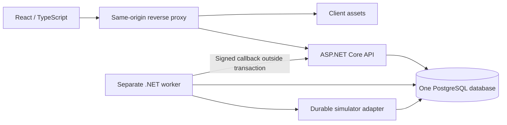

# OrderFlow architecture

Status: accepted design, no application implemented in milestone 01. Behavioral contract: [project specification](project-spec.md). Delivery order: [implementation status](implementation-status.md). Rationale: [ADRs](adr/README.md).

## 1. Deployment and code organization



The simulator is a provider-boundary adapter used by the worker, not a third application or real provider. Its state is durable and independently committed; it must not participate in the merchant business transaction. API and worker share application logic and schema, but have separate process lifetimes and DI scopes. Stopping the worker must not stop API reads/checkout.

Planned layout (directories/projects are not generated in milestone 01):

```text
src/OrderFlow.Api/                    HTTP composition, controllers, auth, filters
src/OrderFlow.Worker/                 Hosted workers and process composition
src/OrderFlow.Application/
  Modules/{Identity,Catalog,Inventory,Ordering,Payments,Notifications,Reporting}/
    <feature>/                       Domain rules, command/query services, DTOs
  Persistence/                       One OrderFlowDbContext, mappings, migrations
  Messaging/                         Outbox/inbox, leases, event contracts
  Common/                            Small actual shared primitives only
client/                              React/TypeScript features and API client
tests/OrderFlow.UnitTests/
tests/OrderFlow.IntegrationTests/     Actual PostgreSQL + HTTP + worker tests
docs/adr/
```

Three production .NET projects are enough. Use feature folders within the application assembly with clearly named services/entities and narrow module interfaces; no separate repository per entity, no generic repository hiding SQL, no event bus or mediator package merely for layering. Domain rules should be small methods/value types where useful; transaction orchestration belongs in application services. Controllers validate HTTP shape, authorize, call one use case, and translate outcomes. API/worker never duplicate core business rules.

## 2. Platform and version policy

Target the stable .NET 10 LTS / ASP.NET Core 10 / EF Core 10 family with the compatible Npgsql EF provider, PostgreSQL 18, Node.js 24 LTS, React/TypeScript, TanStack Query, and Zustand. .NET 10 LTS is selected from the [official support policy](https://dotnet.microsoft.com/en-us/platform/support/policy/dotnet-core). No previews. These are platform-family decisions, not installed dependency claims.

Inspection found SDK `10.0.114`, ASP.NET Core/.NET runtimes `10.0.14`, Node `v24.19.0`, npm `11.17.0`, Python `3.12.3`. There are no repository manifests/locks or installed project packages to preserve. Milestone 01 installs nothing. Milestone 02 must verify the available SDK's official support and pin an actual supported SDK in `global.json`; pin exact NuGet versions centrally and tool versions, use package lockfiles and locked restores. Milestone 04 must select compatible stable frontend versions from official releases, use exact versions without `^`, `~`, `*`, or `latest`, pin package-manager/runtime versions and commit its lockfile. Milestone 03/25 pins an actual PostgreSQL image patch/digest. Do not guess future patch numbers or confuse runtime and SDK version numbers. Consult official docs when writing version-sensitive APIs and record the resolved versions in status.

## 3. Module and schema ownership

Use one `OrderFlowDbContext` derived from Identity's EF context, with all mappings registered explicitly and one ordered migration chain. One context/connection/transaction permits atomic coordination across Ordering, Inventory, Payments, and Messaging. Separate DbContexts per module and distributed transactions would add complexity without value here.

| Owner/schema | Main records | Ownership rules |
| --- | --- | --- |
| Identity / `identity` | Identity users, roles, claims, login/security data | Identity APIs own password/role/session rules; Customer is default role |
| Catalog / `catalog` | Products, normalized SKU, price, active, version | Catalog alone changes product data; checkout obtains an authoritative locked snapshot |
| Inventory / `inventory` | StockBalances, Reservations, StockHistory | Inventory alone changes counters/reservations; ordering calls it inside the shared transaction |
| Ordering / `ordering` | Orders, OrderLines, OrderHistory, CreateOrderRequests | Owns lifecycle, owner ID, immutable totals/line snapshots, expiry, original responses |
| Payments / `payments` | Attempts, Captures, Refunds, PaymentRequests, ProviderEvents | Owns provider references, observations, compensation intentions, reconciliation |
| Payments simulator / `simulator` | ProviderAttempts, ProviderCaptures, ProviderRefunds, callback deliveries | Same database for local durability, fresh independent unit of work; merchant rules cannot directly mark provider success |
| Notifications / `notifications` | Deliveries | Local delivery records keyed by event/template/recipient; no external mail prerequisite |
| Reporting / `reporting` | OrderSnapshots, daily sales contributions/checkpoints | Derived data only; never authorizes payment, stock, or ownership |
| Shared infrastructure / `messaging` | Outbox, Inbox, lease/retry metadata | Atomic durable intents, delivery/consumer identities; not a separate business module |

Schemas describe ownership, not independent databases. Cross-schema FKs are allowed for core transactional integrity: order owner -> Identity user, order line -> product, reservation -> order/product, attempt -> order, capture -> attempt, refund -> capture. Keep snapshots immutable despite FKs. Use restrictive deletes for business records; do not cascade-delete financial/history/idempotency rows. Event payloads and derived projections use IDs, with no cross-module entity navigation required. Only owner module services write owned tables; application orchestration can call multiple owner services using the same context. Reporting consumers may read authoritative data if needed but cannot write business tables.

## 4. Persistence constraints and indexes

- Required fields are NOT NULL. Add CHECKs for positive prices/quantities/totals, USD sales currency, valid states, `0 <= Reserved <= OnHand`, `ExpiresAt = CreatedAt + interval '15 minutes'`, and positive versions. Precision/scale is explicit. Reject extra precision before SQL conversion; numeric scale alone could round.
- Product SKU unique after normalization. One StockBalance/product, one Reservation/order/product, one order line/order/product. Product creation and initial zero stock row commit together.
- Unique CreateOrderRequests `(UserId,Operation,Key)` stores canonical body/hash, order ID, status, response bytes/type/Location. All columns use explicit bounded types. Successful request/order/reservations commit together; no separately committed unfinished claim.
- Unique PaymentRequests `(UserId,Operation,OrderId,Key)` links a persisted accepted attempt snapshot. Attempts have independent UUID/provider request key; a partial unique index on OrderId covers states Queued/Pending/Unknown. Provider identity is namespaced by provider name. Unique `(Provider,ProviderCaptureId)` protects capture evidence; Orders.WinningCaptureId is nullable/unique, and Captures.AppliedOrderId is nullable/unique to allow only one winning capture per order. Association/amount/reservation checks remain transactional service rules.
- Refunds are unique `(Provider,ProviderCaptureId,RefundPurpose)` with v1 purpose FullCompensation, and have their own unique provider refund key. Callback ProviderEvents are unique `(Provider,ProviderEventId)` and store authenticated payload hash/minimal structured facts; compare payload on duplicate. Never store signing secrets in those records.
- StockHistory is unique `(OperationId,ProductId,EffectKind)`; effect kinds Adjustment/Reserve/Consume/Release. Use independent immutable operation IDs (order creation, cancellation/expiry transition, winning capture, admin adjustment). Sum of deltas from zero reconciles stock balances; Active reservation quantity sum reconciles Reserved. One effect per reservation transition is enforced by state guard and uniqueness.
- OrderHistory unique `(OrderId,Version)`; Outbox unique EventId, with a producer effect identity preventing a second event for the same aggregate/version/type. Inbox unique `(ConsumerName,EventId)`; Notifications unique `(EventId,Template,RecipientUserId)`; report snapshot primary key OrderId.
- Index due PendingPayment orders by `(ExpiresAt,Id)`, due work by `(Status,NextAttemptAt,Id)`, active reservations by order, own orders by `(UserId,CreatedAt,Id)`, and order/payment/provider lookup FKs. Do not index arbitrary future search fields.

Cross-table invariants, such as order total equalling its line sum or Reserved equalling Active reservation quantities, cannot be guaranteed with row CHECKs. Enforce them with the shared transaction/locks and integration reconciliation tests; [PostgreSQL constraints documentation](https://www.postgresql.org/docs/18/ddl-constraints.html) explicitly limits CHECK to row data. Runtime database roles can SELECT/INSERT history but cannot UPDATE/DELETE it; a separate migration owner handles schema changes. Migrations are an explicit operator step, never raced by API and worker at startup.

## 5. Units of work, locks, and retries

Async I/O propagates CancellationToken from HTTP or worker shutdown. A DbContext is scoped to one unit of work and never shared across concurrent tasks. A worker creates a scope per claimed business operation; bounded parallel workers each get their own context. EF Core documents that [DbContext is not thread-safe](https://learn.microsoft.com/en-us/ef/core/dbcontext-configuration/).

Use Read Committed with explicit row locks, guarded writes, and unique constraints. [PostgreSQL Read Committed](https://www.postgresql.org/docs/18/transaction-iso.html) re-evaluates an UPDATE condition after a conflicting update; still check affected-row counts. Do not assume wrapping read-check-write in a transaction alone prevents overselling.

Lock order: request-idempotency claim when relevant -> existing order -> payment/capture rows -> catalog products in ascending UUID -> stock balances/reservations in ascending product UUID. A transaction skips unused levels; it must never acquire an earlier level after a later one. CreateOrder claims its key, locks catalog products for stable price/active snapshots, then stock in sorted order; it inserts its new order without contending on an existing order lock. Catalog edits lock product first; stock adjustment locks its stock row and never later acquires product/order locks. Confirmation/cancel/expiry lock the order before reading eligibility, then associated rows, then inventory. Product deactivation does not invalidate existing reservations. Bulk expiry processes one order per short unit of work; avoid a batch lock pattern that reverses order/inventory lock ordering.

Reserve using guarded SQL (`Available >= requested`) and require exactly one affected balance per line. Consume/release require Active reservation and matching PendingPayment order guard under the order lock. Roll back the entire checkout if any product/stock update fails. Do not use `Task.WhenAll` over context operations or in-process locks for durable correctness. Use explicit expectedVersion predicates for Admin edits/fulfillment.

Classified PostgreSQL deadlock `40P01` and serialization `40001` can retry the whole database-only unit of work, at most 3 total attempts with bounded backoff/jitter and cancellation. Recreate scope/context and re-read state each attempt. Expected `23505` on a named deduplication constraint takes the defined replay/conflict path, not a generic transient retry. Validation, insufficient stock, unauthorized access, unknown SQL errors, and permanent provider errors are not blindly retried. Connection loss at commit is uncertain; reconcile through the operation identity. Do not retry an entire transaction containing provider I/O. Configure lock/command/network timeouts explicitly in the implementation and document their actual values; never hide failure as HTTP 200 or empty data.

## 6. Main flows

1. **Create order:** authorize Customer/CSRF -> normalize/hash items -> begin transaction and claim key -> replay or lock products/stock -> sample time -> build authoritative line snapshots -> guarded reserve -> insert order/reservations/history/outbox -> serialize/store original 201 -> commit -> return. No external dependency is contacted.
2. **Cancel/expire:** lock order -> sample time -> validate ownership/state/deadline -> release each Active reservation, append history, change order/version, append event -> commit. Cancel after expiry uses Expired, with committed mutation and 409 response.
3. **Start payment:** lock order and validate owner/deadline -> resolve client key/current active attempt -> persist attempt and work intention -> commit -> return 202. Replays resolve before new eligibility checks so the original accepted attempt remains retrievable after later state changes. Worker claims submission -> ends claim transaction -> calls provider using stored attempt key -> records result or Unknown in a fresh transaction. A network timeout never means payment Failed by itself.
4. **Callback:** bound body size -> verify HMAC over raw bytes + signed timestamp -> validate schema -> insert provider receipt and messaging inbox atomically -> commit -> return 202. Worker processes receipt under order/payment locks; matching on-time capture consumes inventory/confirms, late/surplus/mismatched capture records refund intention. State/history/capture/refund/outbox/inbox completion commit together. No external refund during that transaction.
5. **Refund:** claim durable intention -> commit -> call/query simulator with original refund key -> fresh scope persists success/uncertainty/permanent failure and event. Expired lease may repeat the call; provider key and local uniqueness protect financial effects.
6. **Publish/consume:** claim outbox -> commit -> deliver locally to identified consumers -> each consumer records inbox/effects atomically -> acknowledge with lease token. Notifications/reporting are independent; one failure does not undo another or checkout. A producer event is completed only when each required consumer delivery is durably accepted; per-consumer delivery progress is stored, not inferred from one global success flag.

## 7. Worker delivery and simulator details

Use PostgreSQL work records and `FOR UPDATE SKIP LOCKED` for queue claims only, not as a shortcut to bypass stock/order contention. [SELECT locking documentation](https://www.postgresql.org/docs/18/sql-select.html) describes this queue-oriented behavior. A short claim transaction assigns a fresh lease token, owner, and UTC lease deadline. Completion/reschedule requires matching token; stale workers cannot overwrite newer job status. Durable business effects still need state guards and unique identities even if a lease expires during work. Inbox consumer effects verify the current lease token inside the transaction or rely on an atomic unique handled marker before applying effects; a prior read outside the transaction is insufficient.

Initial worker defaults: claim at most 20 due items, at most 4 concurrent independent scopes, 60-second lease, 15-second external timeout, idle poll every 5 seconds through a cancellable time abstraction. Durable transient delivery retries allow 8 total attempts with delays 5s, 15s, 30s, 1m, 2m, 5m, 10m; then retain Failed/NeedsAttention with last error. Database unit-of-work retries (maximum 3) are distinct from these delivery attempts. Unknown financial outcomes must be reconciled before another submission; exhausted reconciliation remains visible and can be resumed with the original identity. Operator replay uses a documented application maintenance command with an operation ID, audit reason, and same durable identity, not direct stock/financial SQL edits. The command is implemented with operability milestones, not this one.

Simulator submission/query/refund operations are idempotent and durable under provider keys in `simulator`. Run these in independent scopes after the merchant transaction has committed, even though both schemas share a physical database. It can emit signed HTTP callbacks and redeliver with the same ProviderEventId. Test controls configure success/failure/delay/timeout/duplicate callbacks through injected scenarios or explicit development-only operator configuration; no customer `paid=true` or success endpoint. Persist a provider capture before acknowledging it so restart/query can recover uncertain merchant results. The simulator emulates the boundary, not real provider security/settlement guarantees.

Callback HMAC-SHA256 uses a dedicated external signing secret, signed Unix-seconds delivery timestamp plus `.` plus raw body bytes, and fixed-time signature comparison. Reject timestamp skew beyond 5 minutes using TimeProvider (equal boundary allowed); every redelivery is re-signed with a fresh delivery timestamp but keeps the same event ID/business payload. Provider secret and delivery signature are not event deduplication IDs. Enforce a 64 KiB callback body limit. Do not authenticate callbacks by cookie, IP alone, browser roles, or frontend payment result. Secrets are injected; no actual secret is documented or committed.

## 8. Browser, security, and operational boundaries

ASP.NET Core Identity owns password hashing and auth cookies. Cookie is HttpOnly, Secure in HTTPS, SameSite=Lax, host-only, Path=/; use an appropriate `__Host-` name in HTTPS. Share persisted Data Protection keys between API instances and across restarts; keep key material outside Git. HTTP local development may use a separately named development cookie and must be documented. Disable permissive cross-origin credential CORS. Reverse proxy terminates HTTPS and forwards only trusted proxy headers. Registration/login use Identity validation, generic authentication errors, lockout, and bounded request rates; actual limits are pinned with implementation.

Use a global MVC antiforgery validation policy for all unsafe browser methods; registering antiforgery services alone does not validate JSON requests. Provide a no-store token endpoint and explicitly exempt only the signed callback. See [official ASP.NET Core antiforgery guidance](https://learn.microsoft.com/aspnet/core/security/anti-request-forgery?view=aspnetcore-10.0). Keep request tokens in client memory and refresh after identity changes. Cookie is never readable by Zustand. Persist cart product IDs/quantities only; no auth tokens or trusted totals in local storage. TanStack Query owns fetched server entities; Zustand owns cart/UI state. Checkout stores its pending body/key locally so a lost response can retry exactly; create a new key when the normalized cart changes, and do not automatically submit a different body under an uncertain old key.

Log structured operation/order/attempt/event IDs, state transitions, counts, durations, classified errors, and trace/correlation IDs. Do not log passwords, cookies, CSRF tokens, provider secrets/signatures, raw callback bodies, full email, or connection strings. Metrics cover pending expiry lag, oldest due work, failed deliveries/refunds, callback rejects, and stock conflicts. Liveness is process health; readiness verifies database connectivity/schema without leaking details. Worker heartbeat/backlog monitoring distinguishes a live API from progressing background work. Optional notification/reporting failures never enter the checkout critical path.

## 9. Verification and trade-offs

Domain tests exercise state/price/time rules with injected clocks. Integration tests migrate actual isolated PostgreSQL, exercise SQL constraints/transactions and HTTP auth/CSRF, and use separate connections for race participants. Use deterministic hooks before contested writes and PostgreSQL lock/connection observation where necessary to prove arrival; do not demand a second participant reach a barrier while the first holds its required row lock. Client tests exercise exact cents and retry behavior; browser smoke tests use the same-origin proxy. Fault injection covers rollback, lost commit response, crash after provider effect, stale leases, reordering, and recovery.

One shared context/migration chain couples modules intentionally and makes atomic inventory/payment invariants explainable. Row locks trade some throughput for simple correctness. One database is an availability bottleneck. Polling/leases produce duplicates and lag. The simulator cannot prove real-provider behavior. Full response retention consumes storage. Application time assumes synchronized hosts. No public deployment or production security/compliance claim is part of v1. See the specification's acceptance matrix for required evidence and deferred features.
