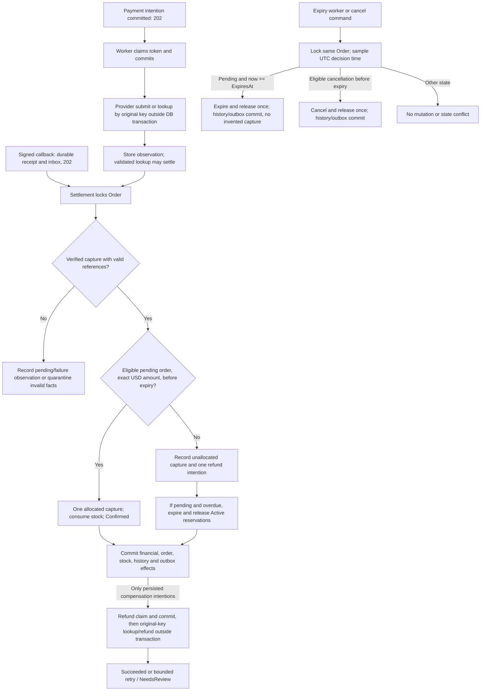

# Transaction and recovery flows

These diagrams describe shipped code, not a proposed platform. API and Worker share application modules/a scoped EF Core context and PostgreSQL schemas. A separate simulator uses its own provider database. nginx serves the React app, API and authenticated WebSocket hub under one HTTPS origin. RabbitMQ and Redis are delivery/presentation dependencies, never inventory authorities. See [acceptance audit](acceptance-audit.md) for outstanding obligations.

## Checkout and reservation

```mermaid
sequenceDiagram
    participant B as Customer browser
    participant A as API replica
    participant D as PostgreSQL
    B->>B: Persist per-user normalized body and key
    B->>A: POST /api/orders + cookie + CSRF + key
    A->>A: Authenticate, authorize, validate 1-100 distinct lines
    A->>D: Read existing user/operation/key snapshot
    alt Already completed with identical canonical body
        D-->>A: Original 201 bytes and Location
    else New intention
        A->>D: BEGIN; INSERT unique idempotency claim
        Note over A,D: A concurrent unique loser rolls back first, then reads winner
        A->>D: Categories/products FOR SHARE, canonical UUID order
        A->>D: Balances FOR UPDATE, canonical product UUID order
        A->>D: Sample UTC time; create immutable order/items, 15-minute expiry
        A->>D: Reserve all lines; append stock and order history
        A->>D: Insert outbox event and exact 201 response snapshot
        A->>D: COMMIT all effects, or roll back every line
    end
    A-->>B: 201 snapshot; GET gives current order state
    Note over B,A: Lost response: replay the SAME body/key, even after price/status changes
```

`CheckoutService`, `CheckoutRequest`, `InventoryLocking` and `OrderDatabase` implement this flow. PostgreSQL arbiters are the unique `(UserId,Operation,Key)` identity and row locks, not a process lock or disabled button. A different canonical body with the same successful key conflicts409. Validation/business failures roll back the claim. Classified contention returns503 without implicit retry; transport/commit uncertainty requires the same intention. The browser records it before POST and fences account/tab changes; explicit abandonment does not cancel an already committed order. The device cart is intentionally shared across account changes; private Query data is purged/fenced, and pending operations are user-scoped.

Money is decimal/numeric(18,2) in USD, serialized as decimal strings; client estimates use bigint cents. Checkout snapshots current database prices/names and availability. Cart addition reserves nothing. Cache hits never authorize stock or payment.

Locking is operation-specific: checkout claims its key, then sorted category/product SHARE locks, then sorted inventory UPDATE locks; it inserts a new order. Existing-order mutations lock Order first. Settlement then locks provider transaction/capture advisory identities, attempt and callback/inbox rows as applicable, then sorted balances/reservations. StartPayment locks Order **before** reading/claiming its client key; it does not follow checkout's insert-first path. Catalog edits lock target category before product; stock-only commands lock their balance and never later acquire order/catalog locks. Avoid one invented universal lock sequence. Transaction-local order/checkout budgets are5s lock/20s statement; general EF command budget30s. One DbContext is used sequentially per unit of work.

## Payment versus expiry



`PaymentSettlement` is shared by callback processing and authenticated provider reconciliation. Eligibility time is sampled **after the Order lock**, then frozen during inventory waits; receipt/provider occurrence times do not grant an earlier eligibility decision. Equality expires. The expiry worker uses SKIP LOCKED on due orders; it cannot bypass a contender holding that order lock. A verified late/cancelled/surplus/wrong-amount USD capture remains a financial fact and is compensated; it never resurrects the order or consumes released stock. Unsupported/mismatched references are quarantined for investigation, not attached to arbitrary orders. Failed attempts can later acquire monotonic capture evidence. Redirects/countdowns never authorize state changes.

The lookup/submit phase and its completion each have separate DI scopes/DB transactions. No merchant transaction spans provider HTTP. Payment/refund completion checks the current token; ADR-020 permits completion after lease expiry if nobody reclaimed it, but never after a newer token wins. Outbox/email completion additionally requires a live unexpired lease. Provider idempotency is still necessary: a lease alone cannot undo an external effect. Client payment replay uses `StartPayment:v1/<orderId>` plus user/key; provider submission uses `payment-<attempt UUID N>`, refund uses `refund-<refund UUID N>`. Callback identity, provider transaction/capture IDs, checkout key and refund key are distinct.

## Outbox, inbox and external delivery

```mermaid
sequenceDiagram
    participant A as Business transaction
    participant D as PostgreSQL
    participant W as Outbox worker
    participant R as RabbitMQ
    participant C as Notification consumer
    participant H as API hub / Redis
    A->>D: State, required history and outbox COMMIT
    W->>D: SKIP LOCKED claim, new owner/token/60s lease; COMMIT
    W->>R: Publish same EventId, mandatory routing and confirms
    W->>D: Conditional Published update for live owner/token
    R->>C: Manual-ACK delivery, possibly duplicated/reordered
    C->>D: BEGIN; unique consumer/EventId inbox
    C->>D: Validate owner/history; notification + child outbox + optional email intention
    C->>D: Inbox processed; COMMIT
    C-->>R: ACK only after commit
    Note over C,D: Commit then lost ACK: redelivery sees inbox, no second durable effect
    W->>R: Publish child notification-created event
    R->>H: API consumer sends user-specific live hint via backplane
    H-->>H: Client invalidates queries; reconnect refetches durable HTTP state
```

`Published` means broker handoff, not consumer completion or browser receipt. Inbox `(ConsumerName,EventId)` protects one local consumer effect; notification uniqueness and immutable identities reinforce it. No global event ordering or exactly-once external delivery is promised. Durable notifications are authoritative; SignalR sends hints and can duplicate/lose them. WebSockets negotiate with path-scoped affinity; Redis fanout does not share negotiation tokens. React has bounded reconnect plus focus/poll/manual catch-up.

Confirmation email is a separate durable intention with its own claim and sender. The Development SMTP/Mailpit adapter has no idempotent-send/lookup guarantee: accepted mail can duplicate after response loss/crash. A stable Message-ID is not proof of recipient deduplication. Only the implemented Admin email retry is available: original delivery/provider identity, audited operation/reason/risk acknowledgement, concurrency checks and monotonic lifetime attempts. There is no generic outbox/job/refund replay API.

| Work | Actual policy |
| --- | --- |
| Outbox publication | At most8 claims,60s token lease; classified retry delays5/15/30/60/120/300/600/600s; exhaustion/permanent failure is Failed; lost confirm may republish original EventId |
| Payment submission/reconciliation/refund | Shared attempt budget or refund budget8,60s leases, same backoff schedule; uncertainty looks up original key, then uses original request; attention/NeedsReview is visible, not automatic success |
| Callback settlement SQL contention | Up to8 durable inbox attempts,5s delay; unrelated exceptions propagate |
| Notification/realtime message rejection | Work →5s delay →retry-work →parked dead queue, no infinite immediate requeue; quorum delivery limit5 also bounds repeated unacked redeliveries |
| Consumer connection recovery | Up to8 sessions with classified1/5/15/30/60/120/300s delays; fatal/exhausted failure stops worker, optional API dispatch can suspend without taking checkout down |
| Email |8 automatic attempts/cycle,60s live owner/token lease, same bounded backoff; audited manual new cycles retain original identity/lifetime counters |

API readiness requires PostgreSQL/schema; liveness is process-only. RabbitMQ/email/Redis/exporters do not automatically deny checkout while the outbox can buffer, subject to finite storage/capacity. Worker readiness additionally probes configured broker/SMTP, not proof of progress. Repair dependencies and let original work retry/reclaim; inspect exhausted work without resetting counters or inventing replacement financial identities. Restart an API dispatcher suspended after finite failures. See [recovery](payment-recovery.md), [messaging](messaging.md), [email](email-delivery.md) and [observability](observability.md).

Cache is distributed-only cache-aside, no L1: product catalog fields and category detail, JSON<=16KiB,30s absolute deadline anchored before source read. Availability comes separately from PG; checkout uses locked PG data. Mutation invalidation happens after commit. Stale refill, delete failure or crash can retain old presentation until its original deadline, assuming synchronized clocks; an already in-flight HTTP response can arrive later. Redis errors log/count and fall back to DB; database failures propagate. No filtered-list/private/account/order/checkout-decision cache. See [cache contract](catalog-caching.md).

Standalone manual stock receipts/adjustments currently atomically update balance+append-only ledger **without an inventory integration event**. Order-related reserve/release/consume effects participate in their order/payment outbox transaction. Stock integration events and enriched order envelopes (`confirmedAt`, winning capture reference) remain explicitly outstanding spec obligations, not prerequisites silently declared complete; direct financial reports use captures and immutable items instead.
